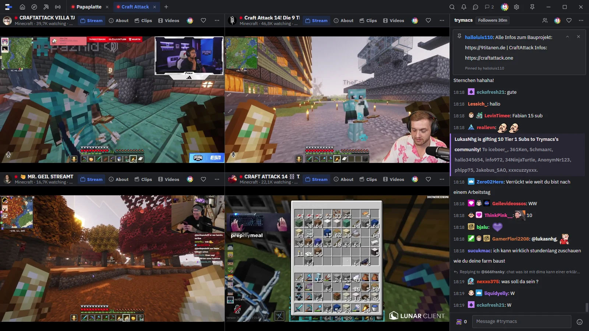
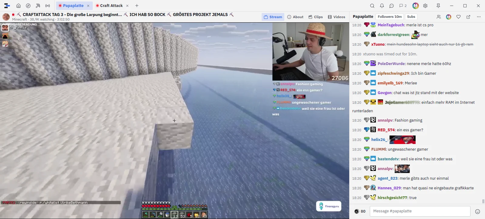
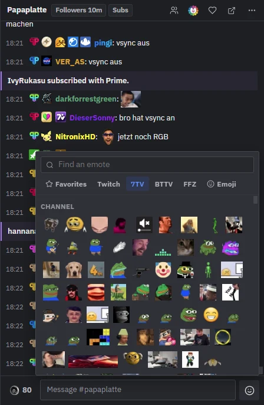
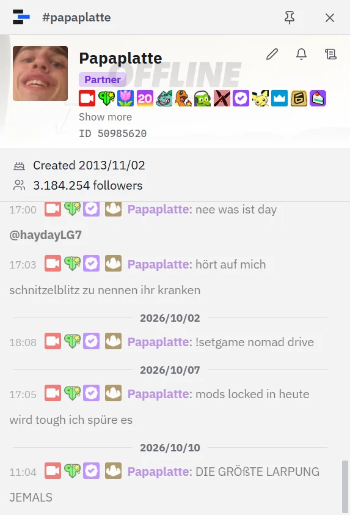
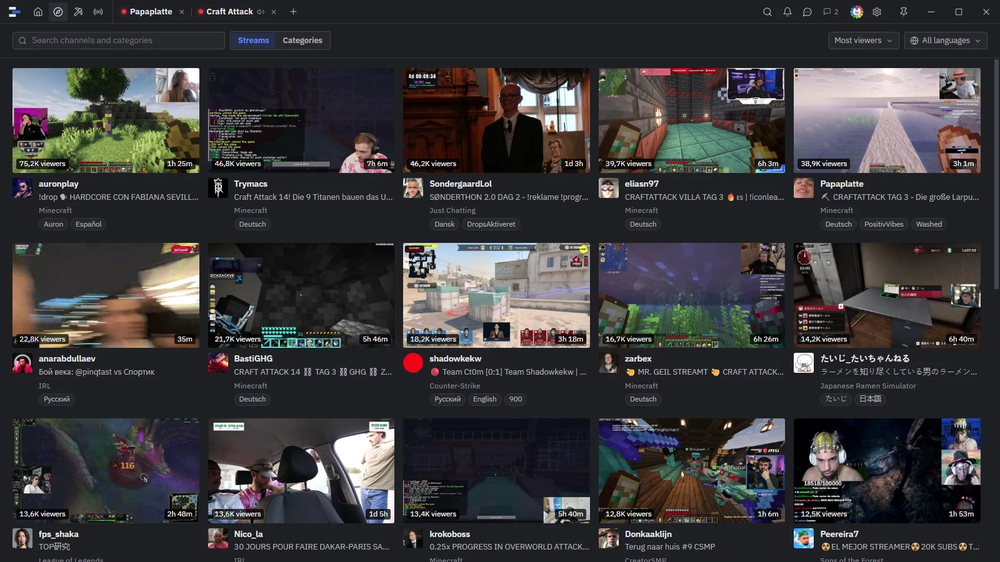
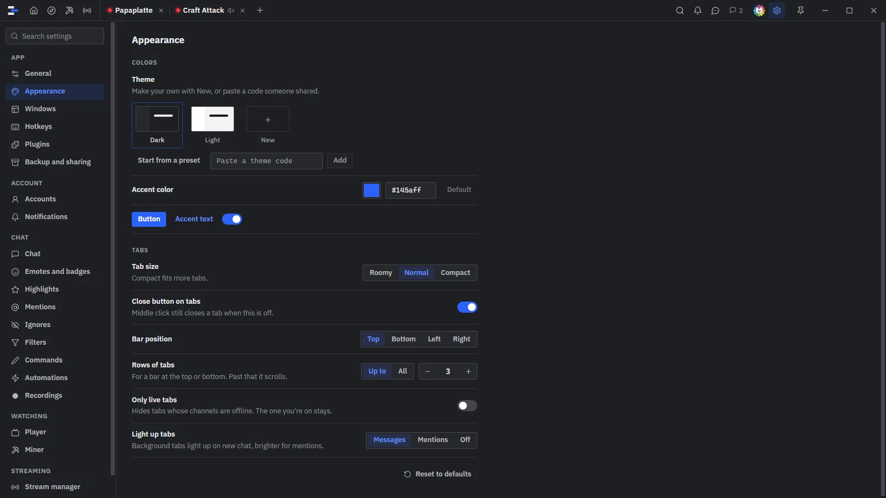

<p align="center">
  <picture>
    <source media="(prefers-color-scheme: dark)" srcset="logo/png/mark-dark-128.png">
    
  </picture>
</p>

<h1 align="center">cyex deck</h1>

<p align="center">
  A light Twitch app for Windows. Streams, chat, the miner, mod tools and your own stream in one window,<br>
  so you never need twitch.tv or Chatterino again.
</p>

<p align="center">
  <a href="https://github.com/cyex-app/cyex-deck/releases"><b>Download for Windows</b></a>
  &nbsp;·&nbsp; <a href="#install">Install</a>
  &nbsp;·&nbsp; <a href="#features">Features</a>
  &nbsp;·&nbsp; <a href="#shortcuts">Shortcuts</a>
  &nbsp;·&nbsp; <a href="#build-from-source">Build from source</a>
</p>



> **Test build 0.1.06.** Windows 10 or 11, 64-bit. Not affiliated with Twitch. The app uses Twitch's internal API the way other third-party clients do, so use it at your own risk.

## Why cyex deck

- **Light.** Most of the app is Rust. The installer is about 6 MB, and with one chat open the app uses about 150 MB of memory. Each extra chat adds only a little, and it has been tested with 100 tabs.
- **Everything in one place.** Watching, chatting, channel points, moderation, your own stream and your Twitch account all live in one app.
- **Made for many channels.** Put streams and chats side by side, group your tabs, pop them out onto other screens and save the whole layout.
- **Chatterino comforts built in.** 7TV, BTTV and FFZ, highlights, filters, custom commands, logs, usercards and Lua plugins. You can bring your Chatterino tabs along too.

## Features

### Watch



- **Tabs:** any number of them, each showing stream and chat, only the stream or only the chat. Tabs are tied to the channel's user id, so renamed channels stay put. You can give tabs your own names, emoji included.
- **Tiles:** several channels in one tab. Drag them around, and drop a chat on any side of its stream. Every tab keeps its own layout.
- **Tab bar:** put it on any side of the window and group your tabs. Compact size and "only live tabs" are there too. Live tabs show a red dot, reruns a yellow one.
- **Windows:** pop out tabs, chats, the mod view, the stream manager or whispers onto other screens. Closing a pop-out puts it back where it came from. You can save window layouts and minimize to the tray.
- **Small windows** rearrange themselves: the chat moves under the stream and chats stack.
- **Player:** live, VODs, clips and stories, with ad blocking built in. You also get audio only, low latency, video stats and VOD speed.
- **VODs** resume where you left off, preview on the timeline and replay their chat.
- **Mini player:** keeps the stream running while you browse the channel's About page, clips and videos.
- **Out of sight, still playing:** a stream keeps playing when you switch to a tab without one. After a minute out of sight it drops to the lowest quality, and switches back when you return.
- **Clips:** make one from any live channel, with Twitch's own editor or as the last 30 seconds. Clip links in chat play in the app.
- **Media keys** and Windows' media controls work. Picture in picture, and fullscreen on any monitor.
- **Channel points and watch time** count as they do on twitch.tv (with a code sign-in).

### Chat

<table>
  <tr>
    <td width="50%"></td>
    <td width="50%"></td>
  </tr>
</table>

- **Emotes:** Twitch, 7TV, BTTV and FFZ, with zero-width emotes, personal emotes and live "emote added" notices. The emote menu has favorites, most used, emoji, and the channel's sub emotes you don't have.
- **Badges and paints:** from Twitch, 7TV, BTTV and FFZ, each with its own switch.
- **Everything Twitch has:** replies, pinned messages, redemptions, polls, predictions, power-ups, GIFs, a badge picker and a name color picker.
- **Mentions:** your name plus your own words. Each one can be a whole word, match case, catch look-alike letters or be a regex in Rust, JavaScript or Python style. Each can also have its own color, Windows pop-up, sound and taskbar flash.
- **Global mentions:** see your name in channels you don't have open, through the [logs.cyex.app](https://logs.cyex.app) feed. Matching happens on your PC, and your list never leaves it.
- **Highlights:** first-time chatters, messages from web, mobile or other apps, and low-trust users for mods.
- **Filters:** ignored phrases (with regex replace), blocked users, `/hideuser`, muted pings per chat and Chatterino-style filters. Near-duplicates can be greyed out, with a repeat counter.
- **Feed tabs:** collect matching messages from many chats in one place.
- **Search:** one chat (Ctrl+F) with `from:`, `has:link`, `badge:` and `regex:`, or every open chat at once (Ctrl+Shift+F).
- **Commands:** your own commands in Chatty style (`/name text`, `$1`, `$1-`, `$(nick)`), which also work as aliases. Also `/chain`, `/foreach`, `/runin` and `/timer`, custom right-click menus and usercard buttons. `/help` lists them all.
- **Automations:** pattern triggers, counters and a rate limit per channel.
- **Completion:** Tab completes emotes, `/` commands and chatters (`@`), and `!` completes bot commands. Most-used emotes come first.
- **Message box:** length counter, slow mode and timeout countdown, spell check and outgoing translation. Up brings back what you sent, and Ctrl+Enter sends and keeps the text.
- **History:** recent messages show when you join. When Twitch has none, they come from [logs.cyex.app](https://logs.cyex.app). Missed messages are filled in after a reconnect.
- **Reading:** chat pauses while you hover or hold Alt. Link cards show the real domain, and you can translate messages or add a delay to match the stream.
- **Recordings:** record a chat with its pictures and replay it later.
- **Usercards:** followers, account age, roles, sub length, earned badges from every provider, name history and logs by day. You can add a private nickname and note, or highlight that person. Mods also get Twitch's mod logs and quick actions.
- **`#channel`** in a message opens that chat in a window of its own.

### Browse



- **Home:** the channels you follow, live ones first, with a preview on hover. Grid or list, filter and sort, and favorites that work without signing in.
- **Discover:** streams and categories, with tags and a language filter.
- **Multi-view:** Ctrl+click several live channels to open them side by side.
- **Go to (Ctrl+K):** jump to any tab, followed channel or channel by name.

### Miner

- Collects channel points from your own list (drag to set the order) or from everything you follow, minus a skip list.
- Claims bonus chests, moments and drops, joins raids, keeps watch streaks and can sit in chats.
- Optional automatic bets on predictions, with strategies and filters, and community goals.
- Stats per channel and a live log.

### Mod tools

- **Mod view** inside the tab or in its own window: stream, chat, activity, mod actions, AutoMod queue, unban requests, viewers and mass actions. Each panel can be dragged, resized, closed or locked.
- **Mod mode** puts delete, timeout and ban in front of every chat line. You pick the buttons and the timeout lengths.
- `/ban`, `/timeout`, `/unban`, `/warn`, `/nuke` with a preview, and `/pin`.
- **Mass ban, timeout and restrict,** paced to Twitch's limits.
- AutoMod approve and deny, unban requests, suspicious users, mod comments, and adding or removing mods and VIPs.

### Stream manager

- Title, category and tags, viewers, followers, subs and a viewer graph.
- An activity feed with filters, alerts you can replay or skip, and a mod actions log.
- Chat modes, polls, predictions, raids, ads (run, snooze, schedule), markers and Stream Together.
- **OBS text files:** live, title, category, viewers, uptime, followers and subs.

### Your Twitch account

- Whispers, Twitch's notification bell, and live alerts per channel as Windows notifications.
- Your subscriptions (renewal, resub, Prime) and payment methods through Twitch's own pages inside the app.
- Display name, bio, name color and chat badge. Block and unblock users.
- Several accounts with a default one. Each tab picks its own account, or none to read chat anonymously.

### Make it yours



- Dark and light themes, your own accent color, and a theme editor with wallpapers and share codes.
- Five chat fonts built in, plus your own font files.
- **Streamer mode:** always on, or only while a streaming app you list (like OBS) is running. It hides link previews, profile pictures, mod actions, whispers, sounds and notifications.
- **Chat overlay:** a see-through chat window you can click through, for games.
- **Hotkeys:** change every shortcut. Global hotkeys work while another app is in front.
- **Settings search** across every option.
- **Backup and sharing:** export all or some settings to a file or a share code, and import them again. Accounts and sign-ins are never part of it.

### Plugins

Lua 5.4 plugins add commands, change or hide chat lines, add Tab completions, post their own lines with buttons and pictures, and add menu entries. They can also react to channels going live and use HTTP and WebSockets. See [Plugins](#plugins-1) below.

## Install

1. Download `cyex-deck_0.1.6_x64-setup.exe` from [Releases](https://github.com/cyex-app/cyex-deck/releases).
2. Run it. The installer isn't signed yet, so Windows SmartScreen may warn about it: click **More info**, then **Run anyway**.
3. It installs for your Windows user only, without admin rights. If the WebView2 Runtime is missing, the installer downloads it. It's already on Windows 11 and on up-to-date Windows 10.

**Update:** run the newer installer. Your settings, tabs and sign-ins stay.

**Uninstall:** Windows Settings → Apps → Installed apps → cyex deck. Your data stays on the PC; see [Where your data lives](#where-your-data-lives).

## First start

You can watch streams and read chat without an account. To sign in, open **Settings → Accounts**.

| | What you get |
|---|---|
| **No account** | Streams, chat to read, Home favorites. |
| **Sign in with a code** | Chat, following, channel points and the miner, bets, raids, GIFs, power-ups, polls and predictions, the bell, notification settings, clips, the stream manager and faster mass bans. |
| **Sign in with Twitch** | Mod tools and the mod view, payment methods, subscriptions, your bio, the full viewer list for mods and Twitch's clip editor. |

Both sign-ins show a code and open Twitch in a window of the app with the code filled in. Log in there if Twitch asks, then approve. After **Sign in with Twitch**, the account card offers the code tools too, so one account can have both.

Anything your sign-in can't do is greyed out with a flag that says what it needs, **GQL only** or **Twitch sign-in**. Click the flag to sign in.

### Coming from Chatterino

**Settings → Backup and sharing → Import from Chatterino** reads your Chatterino tab layout. Pick `%APPDATA%\Chatterino2\Settings\window-layout.json` (or one of its `.bkp` backups). The forks keep it in the same place.

- Tabs come over in the same order, with their names.
- A Chatterino tab with several splits becomes one tab with several chats.
- You choose chat tabs or chat + stream tabs.
- Channels you already have open, and splits that aren't channels (mentions, whispers and so on), are skipped and listed.

A Twitch account can join 100 chats. Channels past that can come in as anonymous tabs.

## Shortcuts

Every shortcut can be changed in **Settings → Hotkeys**.

| Keys | What it does |
|---|---|
| Ctrl+K | Go to a tab or channel |
| Ctrl+1 … Ctrl+5 | Home, Discover, Miner, Stream manager, Whispers |
| Ctrl+, | Settings |
| Ctrl+T / Ctrl+W | Add a tab / close the tab |
| Ctrl+Shift+T | Reopen a closed tab |
| Ctrl+Tab / Ctrl+Shift+Tab | Next / previous tab |
| Ctrl+Shift+P | Pin the window on top |
| Ctrl+F / Ctrl+Shift+F | Search this chat / every chat |
| Ctrl+H | Hide or show near-duplicates |
| Space, M, F | Play/pause, mute, fullscreen |
| Hold Alt | Pause chat |
| Tab | Complete emotes, commands and names |
| Ctrl+Enter | Send and keep the text |

With the mouse:
- The wheel over the tab bar switches tabs, and middle-click closes one.
- On the player, a click pauses, a double-click goes fullscreen and the wheel changes the volume.

Global hotkeys (show or hide the app, streamer mode, overlay click-through) are off until you set them.

## Where your data lives

| What | Where |
|---|---|
| Settings, one file per area, with daily backups kept for 3 days | `%APPDATA%\cyex-deck\settings\` |
| Plugins, recordings, fonts, wallpapers, miner stats | `%APPDATA%\cyex-deck\` |
| OBS text files (the folder can be changed) | `%APPDATA%\cyex-deck\stream-status\` |
| Sign-in tokens | Windows Credential Manager, never in files or exports |
| Twitch's pages in the app | `%LOCALAPPDATA%\cyex-deck\twitch\` |
| Browser cache | `%LOCALAPPDATA%\app.cyex.deck\` |

To start fresh, close the app and delete these folders. **Settings → Backup and sharing** restores a daily backup.

## Good to know

- `cyex-deck.exe --safe-mode` starts the app without running any plugin.
- Each Twitch account can join 100 chats. Channels it moderates don't count.
- Twitch credits channel points for 2 channels at a time, so the miner takes them from the top of its list. Drops need the game account linked on Twitch first.
- The mod view and the AutoMod queue need **Sign in with Twitch**.
- Global mentions download about 0,8 GB an hour while they're on.
- Clips work on live channels only, while signed in.

## Problems

| Problem | What to do |
|---|---|
| SmartScreen blocks the installer | Click **More info**, then **Run anyway**. |
| The window stays blank | Install or update the [WebView2 Runtime](https://developer.microsoft.com/microsoft-edge/webview2/). |
| Things broke after adding a plugin | Start with `--safe-mode`, then check the plugin's console (Settings → Plugins → `>_`). |
| A feature is greyed out | Click its flag to sign in the way it needs. |

Found a bug? [Open an issue](https://github.com/cyex-app/cyex-deck/issues). Say what you did, what happened and what you expected, and add a screenshot if it helps.

## Plugins

A plugin is a folder in `%APPDATA%\cyex-deck\plugins\<name>\` with an `info.json` and an `init.lua`. **Settings → Plugins** turns them on, shows each one's settings and has a console (`>_`) with its log and a Lua prompt.

```json
{
  "name": "Word counter",
  "version": "1.0.0",
  "description": "Counts lines per chatter.",
  "permissions": [{ "type": "ReadChat" }]
}
```

```lua
local counts = {}

cyex.register_callback(cyex.EventType.Message, function(line)
  if line.sender then
    counts[line.sender.login] = (counts[line.sender.login] or 0) + 1
  end
end)

cyex.register_command("count", function(ctx)
  local who = ctx.words[2] or ""
  ctx.channel:add_system_message(who .. ": " .. (counts[who:lower()] or 0) .. " lines")
end)
```

| Permission | Lets the plugin |
|---|---|
| `ReadChat` | Read lines in open chats |
| `ChangeChat` | Change or hide lines, and clear a chat on screen |
| `SendMessages` | Send messages as you (10 per 30 seconds) |
| `Network` | HTTP, WebSockets and pictures from the hosts it lists. Never this PC or the local network. |
| `FilesystemRead`, `FilesystemWrite` | Files in its own `data` folder |
| `Tabs` | Open a channel or switch tabs, 10 times a minute |

You agree to the permissions when turning a plugin on. An update that asks for more stays off until you agree again. Plugins get 64 MB of memory and a time limit per call, and run without `io`, `os.execute` or `package`.

The API uses Chatterino's `c2` names where they mean the same thing, so a Chatterino plugin ports by renaming `c2` to `cyex` and adjusting what's different.

## Build from source

### What you need

| | Why |
|---|---|
| Windows 10 or 11, 64-bit | The app is Windows-only. |
| [WebView2 Runtime](https://developer.microsoft.com/microsoft-edge/webview2/) | Draws the app. |
| [Visual Studio Build Tools 2022](https://visualstudio.microsoft.com/visual-cpp-build-tools/), workload **Desktop development with C++** | Rust needs its linker, and Lua is compiled from source. |
| [Rust](https://rustup.rs) 1.90 or newer, MSVC toolchain | The app itself. |
| [Node.js](https://nodejs.org) 22.6 or newer, with npm | The UI. |
| [Git](https://git-scm.com) | To clone the repo. |

All of them install with winget. **Open a new terminal** afterwards so the new paths load:

```powershell
winget install Git.Git
winget install Microsoft.VisualStudio.2022.BuildTools --override "--wait --passive --add Microsoft.VisualStudio.Workload.VCTools --includeRecommended"
winget install Rustlang.Rustup
winget install OpenJS.NodeJS.LTS
rustup default stable-x86_64-pc-windows-msvc
```

### Run it

```powershell
git clone https://github.com/cyex-app/cyex-deck.git
cd cyex-deck
npm ci
npm run dev
```

The first start compiles everything, which takes a few minutes. After that, UI changes show up right away, and Rust changes rebuild and restart the app.

### Build the installer

```powershell
npm run build
```

This makes `target\release\cyex-deck.exe`, which runs on its own, and the installer in `target\release\bundle\nsis\`. The first build downloads NSIS by itself.

| Build problem | What to do |
|---|---|
| `link.exe` or `cl.exe` not found, or the `mlua`/`lua-src` build fails | Build Tools or the C++ workload is missing, or Rust uses the GNU toolchain. Run `rustup default stable-x86_64-pc-windows-msvc`, then try again in a new terminal. |
| `npm run dev` says port 5173 is busy | Close the other dev server. |

### For developers

```powershell
cargo clippy --workspace --all-targets -- -D warnings
cargo test --workspace
npm run check
npm run test:ui
```

`cargo test` also regenerates the TypeScript types in `ui/src/ipc/bindings/`.

| Folder | What's in it |
|---|---|
| `app/` | The Tauri app: commands, windows, and the glue between the crates and the UI. |
| `crates/` | `core`, `settings`, `twitch`, `auth`, `chat`, `player`, `emotes`, `miner`, `eventsub`, `moderation`, `plugins`. |
| `ui/` | The Svelte 5 frontend. |
| `logo/` | App icon and logo. |
